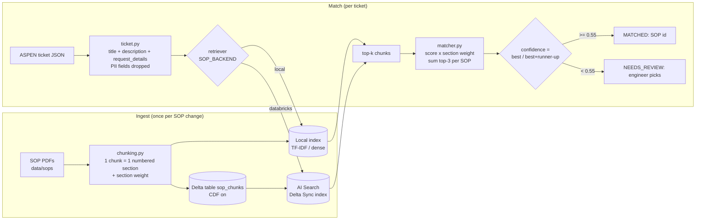

# ASPEN SOP Matcher — Level 0

Given an ASPEN ticket (JSON), find the SOP that governs it.

This is the first step of the larger automation. Every later step depends on it: validation, approval routing, choosing the repo, generating the PR and picking the Jenkins job are all driven by the SOP. It runs on a laptop with no company access, and it can switch to **Databricks AI Search** (formerly Vector Search) through a config change.

## Flow



**Why section weights?** Hits on *Purpose and Scope* or *When to use this SOP* describe what an SOP is for, so they count fully. Hits on *Deployment* count only a little. *Not covered by this SOP* counts zero. Its text names other SOPs' topics (for example, "creating a new service principal: use SOP-SP-002"), so without the zero weight SOP-SP-003 would win tickets meant for SOP-SP-002.

**Why a confidence score?** The four sample SOPs fall into two pairs that are easy to confuse: SP-002 vs SP-003 and UC-001 vs MDL-004. When the top two SOPs score close together, the ticket goes to a person instead of being routed on a guess.

## Layout

```
data/
  tickets/ASPEN-1001.json         UC table SELECT + function EXECUTE   -> SOP-UC-001
  tickets/ASPEN-1002.json         new service principal for batch job  -> SOP-SP-002
  sops/SOP-UC-001_*.pdf           Unity Catalog data access
  sops/SOP-SP-002_*.pdf           new service principal
  sops/SOP-SP-003_*.pdf           access to an existing service principal
  sops/SOP-MDL-004_*.pdf          model / serving endpoint access
scripts/generate_sop_pdfs.py      regenerates the sample PDFs
src/sop_matcher/
  chunking.py                     PDF -> section chunks (shared by laptop + Databricks)
  ticket.py                       ticket JSON -> query text
  retrievers/local.py             TF-IDF (+ optional sentence-transformers)
  retrievers/databricks_ai_search.py
  matcher.py                      chunk hits -> ranked SOPs + confidence
  cli.py                          `index` / `match`
databricks/
  01_ingest_sops.py               volume -> Delta table -> endpoint + Delta Sync index
  02_match_ticket.py              run the matcher inside Databricks
tests/test_matcher.py             sample tickets + near-neighbour SOP cases
```

## Run on your laptop

```bash
python -m venv .venv && source .venv/bin/activate     # Windows: .venv\Scripts\activate
pip install -e ".[dev]"

python -m sop_matcher index
python -m sop_matcher match data/tickets/*.json
python -m sop_matcher match data/tickets/ASPEN-1001.json --json
pytest -q
```

Expected:

```
=== ASPEN-1001 ===
Status     : MATCHED
SOP        : SOP-UC-001 - Unity Catalog Data Access (Catalog / Schema / Table / View / Function / Volume)
Confidence : 0.80
=== ASPEN-1002 ===
Status     : MATCHED
SOP        : SOP-SP-002 - New Service Principal Provisioning (Azure Entra ID + Databricks)
Confidence : 0.88
```

For better matching on paraphrased tickets, add dense embeddings: `pip install -e ".[dense]"`, set `LOCAL_EMBEDDER=sentence-transformers`, then re-run `index`.

## Switch to Databricks AI Search

You can use **Databricks Free Edition** at no cost. It allows one AI Search endpoint and supports Delta Sync indexes but not Direct Vector Access. This project only uses a Delta Sync index, so that is enough.

1. Push this repo to your GitHub account. In Databricks, go to **Workspace → Create → Git folder** and paste the repo URL.
2. Open `databricks/01_ingest_sops.py` and run the first cells. They create `workspace.mlops_sop` and the volume `sop_docs`.
3. Upload `data/sops/*.pdf` into the volume, then run the rest of the notebook. It chunks the PDFs, MERGEs them into the `sop_chunks` table (Change Data Feed on), creates the endpoint and the Delta Sync index (embeddings from `databricks-gte-large-en`), and runs a smoke-test query.
4. From your laptop, copy `.env.example` to `.env` and set `DATABRICKS_HOST`, `DATABRICKS_TOKEN` (a personal access token) and `SOP_BACKEND=databricks`. Then:

```bash
pip install -e ".[databricks]"
python -m sop_matcher match data/tickets/*.json --backend databricks
```

When an SOP changes, update the PDF in the volume and re-run notebook 01. The MERGE handles inserts, updates and deletes, and `index.sync()` re-embeds only the chunks that changed.

## Where this goes next (Level 1)

- **Confluence instead of PDFs.** Swap `chunk_folder()` for a Confluence REST loader that splits pages on headings. The rest of the pipeline is unchanged.
- **LLM step after retrieval.** Pass the ticket and the top-2 SOP chunks to an LLM (a Databricks foundation-model endpoint or Azure OpenAI). Ask it to confirm the SOP and to extract the SOP's *Required information* fields as JSON, including a list of any missing fields. Treat the ticket text strictly as data in that prompt, because users write it.
- **Evaluation set.** Export past ASPEN tickets with the SOP each one was actually handled under, and track top-1 accuracy and NEEDS_REVIEW rate whenever SOPs or weights change.
